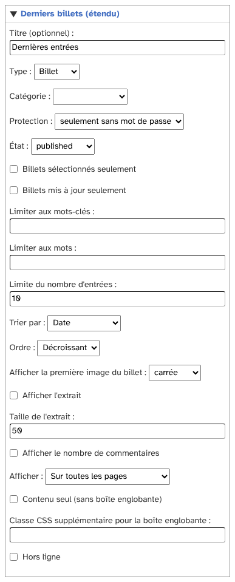
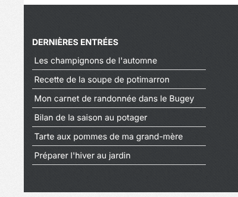

# lastpostsExtend : guide d'utilisation

lastpostsExtend ajoute un gadget « Derniers billets (étendu) » : une liste de billets comme le gadget standard « Derniers billets », avec beaucoup plus de filtres et d'options de tri.

## Table des matières

1. [Ajouter le gadget](#ajouter-le-gadget)
2. [Choisir les billets](#choisir-les-billets)
3. [Trier et limiter](#trier-et-limiter)
4. [Les options d'affichage](#les-options-daffichage)
5. [Bon à savoir](#bon-à-savoir)

## Ajouter le gadget

Allez dans **Gadgets**, ajoutez « Derniers billets (étendu) » à une zone, puis enregistrez. Cliquez sur son nom pour déplier les réglages.

Sur le blog, il affiche une liste de liens vers les billets. Au survol d'un lien, la date et l'heure de dernière modification du billet apparaissent.

## Choisir les billets

* **Type** : billet, page ou galerie (et les types du plugin Muppet s'il est installé).
* **Catégorie** : une catégorie, ou « Sans catégorie ».
* **Billets sélectionnés seulement** : uniquement les billets marqués « sélectionné ».

* **Billets mis à jour seulement** : uniquement les billets modifiés après leur création et leur date de publication. Le tri par date se fait alors sur la date de mise à jour.

* **Limiter aux mots-clés** : une liste de tags séparés par des virgules (si le plugin Tags est actif).
* **Limiter aux mots** : une recherche dans le texte des billets.
* **Protection** : tous les billets, seulement ceux sans mot de passe, ou seulement ceux avec mot de passe.
* **État** : tous les billets, ou seulement ceux d'un état (publié, en attente, programmé, non publié…).

## Trier et limiter

* **Limite du nombre d'entrées** : le nombre maximum de billets (10 si le champ est vide).
* **Trier par** : date, titre ou nombre de commentaires.
* **Ordre** : croissant ou décroissant.

## Les options d'affichage

* **Afficher la première image du billet** : choisissez la taille de l'image, ou « non ».
* **Afficher le nombre de commentaires** : ajoute le nombre entre parenthèses après le titre.

* **Afficher l'extrait** et **Taille de l'extrait** : ajoute l'extrait du billet après son titre, en texte simple, coupé à la taille choisie.
* Les options habituelles des gadgets : page d'accueil seulement, contenu seul, classe CSS, hors ligne.

Si aucun billet ne correspond aux filtres, le gadget n'est pas affiché.

## Bon à savoir

* Un billet sans extrait est affiché sans extrait, même avec l'option cochée.
* Le gadget peut montrer des billets non publiés (filtre **État**) ou protégés par un mot de passe (filtre **Protection**) : leurs titres sont alors visibles par tous les visiteurs du blog.
