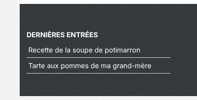
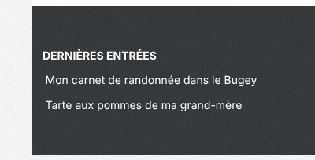
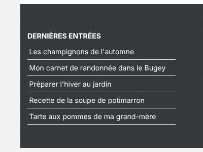
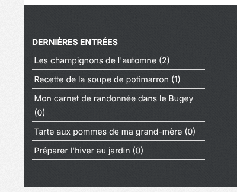

# lastpostsExtend : guide d'utilisation

lastpostsExtend ajoute un widget « Derniers billets (étendu) » : une liste de billets comme le widget standard « Derniers billets », avec beaucoup plus de filtres et d'options de tri.

## Table des matières

1. [Ajouter le widget](#ajouter-le-widget)
2. [Choisir les billets](#choisir-les-billets)
3. [Trier et limiter](#trier-et-limiter)
4. [Les options d'affichage](#les-options-daffichage)
5. [Bon à savoir](#bon-à-savoir)

## Ajouter le widget

Allez dans **Widgets**, ajoutez « Derniers billets (étendu) » à une zone, puis enregistrez. Cliquez sur son nom pour déplier les réglages.

Sur le blog, il affiche une liste de liens vers les billets. Au survol d'un lien, la date et l'heure de dernière modification du billet apparaissent.

## Choisir les billets

* **Type** : billet, page ou galerie (et les types du plugin Muppet s'il est installé).
* **Catégorie** : une catégorie, ou « Sans catégorie ».
* **Billets sélectionnés seulement** : uniquement les billets marqués « sélectionné ».

* **Billets mis à jour seulement** : uniquement les billets modifiés après leur création et leur date de publication. Le tri par date se fait alors sur la date de mise à jour.

* **Limiter aux mots-clés** : une liste de tags séparés par des virgules (si le plugin Tags est actif).
* **Limiter aux mots** : une recherche dans le texte des billets.
* **Protection** et **État** : voir « Bon à savoir ».

## Trier et limiter

* **Limite du nombre d'entrées** : le nombre maximum de billets (10 si le champ est vide).
* **Trier par** : date, titre ou nombre de commentaires.
* **Ordre** : croissant ou décroissant.

## Les options d'affichage

* **Afficher la première image du billet** : choisissez la taille de l'image, ou « non ».
* **Afficher le nombre de commentaires** : ajoute le nombre entre parenthèses après le titre.

* **Afficher l'extrait** et **Taille de l'extrait** : voir « Bon à savoir ».
* Les options habituelles des widgets : page d'accueil seulement, contenu seul, classe CSS, hors ligne.

Si aucun billet ne correspond aux filtres, le widget n'est pas affiché.

## Bon à savoir

* L'extrait des billets n'est jamais affiché, même avec l'option cochée et des billets qui ont un extrait.
* Les billets protégés par un mot de passe n'apparaissent jamais dans la liste, même avec « Protection » réglée sur « tous » ou « seulement avec mot de passe » : le widget n'est alors pas affiché.
* Le filtre « État » ne fonctionne pas comme annoncé : « publié » est la valeur par défaut, « tous » n'affiche pas les billets non publiés et « unpublished » affiche aussi les billets publiés.
* Les valeurs de « État » (pending, scheduled, unpublished, published) ne sont pas traduites en français.
* Le titre du widget est placé à l'intérieur de la liste (`<ul>`), ce qui n'est pas du HTML valide.
